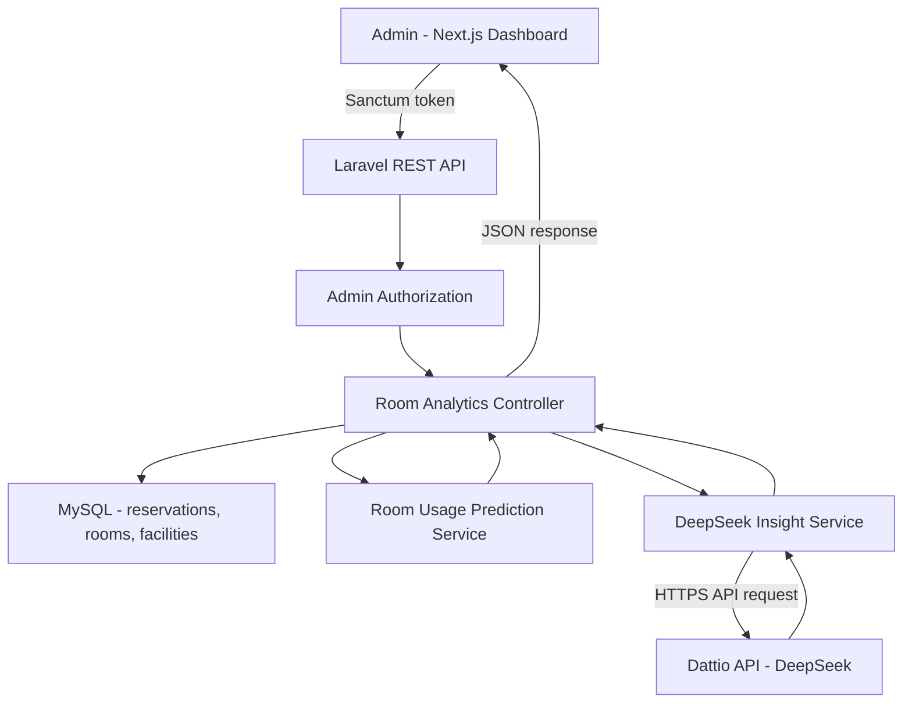

# Rancangan AI Room Usage Analytics — RuangKuliah

> **Status:** Rancangan / belum diimplementasikan  
> **Tanggal pembaruan:** 23 November 2026  
> **Target pengguna:** Admin  
> **Repository:** [BLUE3BLACK2/ruangkampus](https://github.com/BLUE3BLACK2/ruangkampus)

Dokumen ini menjadi acuan perencanaan fitur analitik penggunaan ruangan dan AI Insights pada proyek RuangKuliah. Dokumen ini bukan bukti bahwa fitur telah selesai dibuat. Implementasi harus mengikuti struktur dan kode terbaru pada branch kerja yang disepakati tim.

---

## 1. Ringkasan

RuangKuliah akan memiliki halaman **AI Room Usage Analytics** pada dashboard Admin. Fitur ini membantu admin memahami pola reservasi ruangan berdasarkan data historis, memperkirakan jumlah permintaan reservasi untuk tujuh hari berikutnya, dan memperoleh penjelasan serta rekomendasi dari model DeepSeek melalui API Dattio.

Rancangan menggunakan arsitektur yang sudah dipakai proyek:

- **Frontend:** Next.js, React, Tailwind CSS, dan Axios.
- **Backend:** Laravel 12 dan REST API.
- **Autentikasi:** Laravel Sanctum dan pemeriksaan role admin.
- **Database:** MySQL.
- **Perhitungan prediksi awal:** PHP pada Laravel (metode statistik sederhana, bukan model Machine Learning).
- **AI Insights:** DeepSeek melalui API Dattio, dipanggil dari backend Laravel.

### Prinsip penting

1. Angka prediksi dihitung oleh Laravel berdasarkan data reservasi. LLM tidak boleh diminta mengarang angka prediksi.
2. DeepSeek bertugas menjelaskan hasil analisis dan menyusun rekomendasi berdasarkan data agregat yang diberikan Laravel.
3. Fitur statistik dan prediksi harus tetap dapat digunakan ketika layanan AI tidak tersedia.
4. Fitur ini hanya dapat diakses oleh Admin.
5. Implementasi tidak boleh mengganggu autentikasi, CAPTCHA Turnstile, API reservasi, maupun pekerjaan anggota tim lain.

---

## 2. Tujuan dan ruang lingkup

### Tujuan

- Menampilkan ringkasan riwayat reservasi yang telah disetujui.
- Menunjukkan hari dan rentang waktu dengan permintaan reservasi tertinggi.
- Memperkirakan jumlah permintaan reservasi selama tujuh hari mendatang.
- Membantu admin memahami data melalui AI Insights.
- Memberikan rekomendasi pengelolaan ruangan yang dapat ditelusuri kembali ke data sumber.

### Ruang lingkup MVP

| Fitur | Keterangan | Prioritas |
|---|---|---|
| Usage Overview | Jumlah reservasi, tren, dan ringkasan penggunaan | Wajib |
| Usage by Day | Distribusi reservasi berdasarkan hari | Wajib |
| Usage by Time | Distribusi reservasi berdasarkan waktu | Wajib |
| Seven-day Prediction | Prediksi jumlah reservasi untuk 7 hari berikutnya | Wajib |
| DeepSeek AI Insights | Ringkasan pola dan rekomendasi berbasis data | Wajib |
| Refresh Insights | Meminta analisis baru dengan pembatasan request | Tambahan |
| Export Report | Mengunduh laporan | Di luar MVP |

### Di luar ruang lingkup MVP

- Persetujuan atau penolakan reservasi otomatis oleh AI.
- Prediksi kehadiran aktual atau jumlah peserta yang benar-benar hadir.
- Penggunaan Python atau layanan Machine Learning terpisah.
- Chatbot umum untuk mahasiswa dan dosen.
- Perubahan otomatis status atau jadwal reservasi.

---

## 3. Arsitektur sistem



### Tanggung jawab setiap bagian

| Bagian | Tanggung jawab |
|---|---|
| Next.js | Menampilkan statistik, grafik, prediksi, status data, dan AI Insights |
| Laravel Controller | Memvalidasi request, memastikan akses Admin, dan membentuk response API |
| Prediction Service | Mengambil/mengolah data historis dan menghitung prediksi |
| DeepSeek Service | Memanggil API Dattio dari server, menangani timeout dan error, memvalidasi hasil |
| MySQL | Menyediakan data reservasi dan ruangan yang menjadi sumber analisis |
| Laravel Cache | Menyimpan hasil agregasi/prediksi/insight sementara agar request tidak berulang |

API Key DeepSeek tidak boleh dikirim ke Next.js atau browser. Semua request ke Dattio dilakukan oleh Laravel.

---

## 4. Data sumber dan aturan analisis

### Tabel yang digunakan

Rancangan awal menggunakan tabel yang sudah ada. Tidak diperlukan migration baru untuk MVP sebelum audit data dan kebutuhan penyimpanan selesai.

| Tabel | Kolom/data yang digunakan |
|---|---|
| `reservations` | `room_id`, `reservation_date`, `start_time`, `end_time`, `participant_count`, `status` |
| `rooms` | `id`, `room_code`, `room_name`, `building`, `capacity`, `status` |
| `facilities` | Informasi fasilitas, jika diperlukan untuk segmentasi |
| `room_facility` | Relasi ruangan dan fasilitas, jika diperlukan untuk segmentasi |

Nama kolom di atas mengikuti rancangan skema RuangKuliah. Sebelum coding, pastikan kembali migration dan model pada branch terbaru; jangan menganggap nama atau tipe kolom berbeda tanpa pemeriksaan.

### Aturan pemilihan data

Untuk ringkasan historis dan prediksi awal:

1. Gunakan reservasi dengan status `approved`.
2. Gunakan reservasi dengan tanggal yang sudah berlalu untuk data historis.
3. Kecualikan `rejected` dan `cancelled`.
4. Jangan menghitung `pending` sebagai penggunaan yang telah disetujui.
5. Terapkan filter tanggal dengan zona waktu aplikasi yang konsisten.
6. Abaikan atau tandai data yang tidak valid, misalnya `end_time` tidak lebih besar dari `start_time`.
7. Jangan mengirim nama, email, NIM, NIP, catatan pribadi, atau token pengguna ke layanan AI.

**Batas interpretasi data:** status `approved` menunjukkan reservasi disetujui, bukan bukti ruangan benar-benar dipakai. Karena itu, istilah yang benar untuk MVP adalah **approved reservation demand / permintaan reservasi yang disetujui**, bukan okupansi aktual atau kehadiran aktual.

`participant_count` adalah jumlah peserta yang direncanakan pada reservasi, bukan jumlah orang yang terbukti hadir. Nilai tersebut tidak boleh dilaporkan sebagai data kehadiran aktual.

---

## 5. Metode prediksi awal

### Tujuan prediksi

Memprediksi **jumlah reservasi yang disetujui** per hari selama tujuh hari berikutnya. Prediksi ini merupakan baseline statistik yang transparan dan mudah diuji.

### Metode MVP: rata-rata historis untuk hari yang sama

Untuk setiap tanggal target, ambil jumlah reservasi yang disetujui pada hari yang sama dalam 4–8 minggu sebelumnya, lalu hitung rata-ratanya.

Contoh ilustrasi untuk hari Rabu:

| Minggu historis | Jumlah reservasi disetujui |
|---|---:|
| Rabu minggu 1 | 20 |
| Rabu minggu 2 | 25 |
| Rabu minggu 3 | 22 |
| Rabu minggu 4 | 29 |

Rata-rata baseline:

\[
\hat{y} = \frac{20 + 25 + 22 + 29}{4} = 24
\]

Hasil contoh tersebut adalah 24 reservasi. Angka ini hanya ilustrasi cara menghitung, bukan hasil dari database produksi.

### Aturan kelayakan prediksi

- Target awal menggunakan 4 observasi historis yang tersedia untuk hari yang sama.
- Jika observasi kurang dari jumlah minimum yang ditetapkan setelah audit data, tampilkan status `insufficient_data` atau `low_confidence`, bukan menyajikan angka sebagai prediksi yang andal.
- Jangan menganggap hari tanpa record sebagai nol secara otomatis sebelum dipastikan bahwa data pada hari tersebut memang lengkap dan sistem sudah aktif mencatat reservasi.
- Simpan metadata jumlah observasi dan periode historis yang digunakan agar hasil bisa dijelaskan.
- Pembulatan hasil prediksi menjadi bilangan reservasi dilakukan secara konsisten.
- Prediksi bukan jaminan dan tidak boleh digunakan untuk menyetujui/menolak reservasi secara otomatis.

### Batasan metode

Rata-rata historis merupakan baseline statistik, bukan model Machine Learning. Metode ini belum menangkap kalender akademik, hari libur, perubahan kapasitas, kegiatan kampus khusus, atau tren jangka panjang. Evaluasi akurasi perlu dilakukan dengan membandingkan prediksi historis terhadap data aktual yang disimpan, sebelum metode ditingkatkan.

---

## 6. Peran DeepSeek AI Insights

DeepSeek menerima ringkasan agregat dari Laravel, bukan akses langsung ke database. AI digunakan untuk menjelaskan hasil, bukan menghitung ulang atau membuat angka prediksi.

### Input AI yang disarankan

Contoh struktur data (angka hanya ilustrasi):

```json
{
  "period": "last_28_days",
  "approved_reservations": 120,
  "busiest_day": "Wednesday",
  "busiest_time_range": "10:00-12:00",
  "room_summary": [
    {
      "room_name": "Aula Serbaguna",
      "approved_reservations": 30
    },
    {
      "room_name": "Ruang Kelas 101",
      "approved_reservations": 25
    }
  ],
  "forecast_next_7_days": [
    {
      "date": "2026-11-25",
      "predicted_reservations": 24,
      "observations_used": 4
    }
  ]
}
```

### Instruksi sistem AI

AI harus diminta untuk:

1. Menjelaskan pola yang terlihat pada input.
2. Menyebutkan periode dan angka hanya jika tersedia pada input.
3. Memberikan rekomendasi operasional yang relevan bagi Admin.
4. Menjelaskan keterbatasan data jika jumlah observasi kurang.
5. Tidak mengarang ruangan, angka, tanggal, fasilitas, maupun kejadian kampus.
6. Tidak menyimpulkan bahwa ruangan benar-benar terisi atau peserta benar-benar hadir.
7. Tidak mengambil keputusan reservasi atau mengubah data sistem.

Contoh prompt:

> Analisis ringkasan reservasi dan prediksi berikut untuk administrator kampus. Jelaskan pola penggunaan yang didukung data dan berikan rekomendasi operasional yang masuk akal. Gunakan hanya informasi dalam input. Jangan membuat angka, tanggal, ruangan, atau fakta baru. Jika data tidak cukup, nyatakan keterbatasannya. Bedakan jumlah reservasi yang disetujui dari penggunaan atau kehadiran aktual.

### Format output yang disarankan

Minta model menghasilkan JSON terstruktur yang divalidasi backend, misalnya:

```json
{
  "summary": "Ringkasan singkat berdasarkan data yang diberikan.",
  "findings": [
    "Temuan yang didukung angka pada input."
  ],
  "recommendations": [
    "Saran yang dapat dipertimbangkan Admin."
  ],
  "limitations": [
    "Keterbatasan data atau metode."
  ]
}
```

Jika output tidak dapat diparse atau tidak sesuai skema, Laravel harus menolak output tersebut dan menampilkan pesan fallback. Jangan menampilkan teks mentah yang tidak tervalidasi sebagai struktur dashboard.

---

## 7. Konfigurasi Dattio dan keamanan secret

Base URL yang diberikan untuk layanan Dattio pada konfigurasi proyek:

```text
https://bandelbanget.xyz/v1
```

Endpoint chat completion dan format payload harus diverifikasi terhadap dokumentasi/daftar model Dattio yang aktif sebelum implementasi. Jangan mengasumsikan nama model DeepSeek tertentu masih tersedia. Ambil ID model yang valid dari daftar model layanan, lalu simpan melalui environment variable.

### Environment variable backend

Tambahkan ke `backend/.env` secara lokal:

```env
AI_BASE_URL=https://bandelbanget.xyz/v1
AI_API_KEY=isi_api_key_baru_di_mesin_lokal
AI_MODEL=isi_id_model_deepseek_yang_tersedia
```

Tambahkan placeholder saja ke `backend/.env.example`:

```env
AI_BASE_URL=https://bandelbanget.xyz/v1
AI_API_KEY=
AI_MODEL=
```

### Konfigurasi Laravel

Tambahkan konfigurasi yang sesuai di `backend/config/services.php` setelah memeriksa struktur file yang sudah ada:

```php
'dattio' => [
    'base_url' => env('AI_BASE_URL'),
    'api_key' => env('AI_API_KEY'),
    'model' => env('AI_MODEL'),
],
```

Service Laravel membaca nilai melalui `config('services.dattio...')`, bukan memanggil `env()` langsung dari class aplikasi.

### Ketentuan keamanan

- Jangan pernah commit `backend/.env`.
- Jangan menaruh key di kode frontend atau variabel `NEXT_PUBLIC_*`.
- Jangan menampilkan API Key dalam log, response API, pesan error, screenshot, dokumentasi, atau commit.
- Gunakan HTTPS, timeout, penanganan status HTTP, dan validasi response.
- Terapkan rate limit untuk endpoint yang memanggil model AI.
- Batasi panjang input dan output token.
- Kirim data agregat seminimal mungkin.
- Jangan mengirim data pribadi pengguna atau isi catatan reservasi.
- Jika key pernah terlihat pada screenshot/chat atau terunggah ke repository, anggap telah terekspos: revoke/ganti key tersebut melalui penyedia layanan.

---

## 8. Hubungan dengan Cloudflare Turnstile

Cloudflare Turnstile adalah mekanisme CAPTCHA dan bukan bagian dari proses prediksi atau pemanggilan DeepSeek.

- Pertahankan konfigurasi Turnstile yang sudah ada.
- Jangan mengganti atau menghapus `TURNSTILE_SITE_KEY` dan `TURNSTILE_SECRET_KEY` ketika menambahkan konfigurasi AI.
- Secret Turnstile hanya boleh diverifikasi di backend.
- AI Analytics tetap menggunakan autentikasi Sanctum dan otorisasi role Admin.
- Jangan meminta CAPTCHA pada setiap request grafik atau analitik untuk Admin yang sudah terautentikasi, kecuali kebijakan keamanan aplikasi yang sudah diterapkan memang mengharuskannya.
- Jangan menyalin secret Turnstile ke `AI_API_KEY` atau sebaliknya.

Nama variabel Turnstile yang sebenarnya harus mengikuti implementasi terbaru repository; jangan mengganti nama yang sudah dipakai tanpa koordinasi.

---

## 9. Rancangan struktur file

Struktur berikut adalah **usulan**, bukan klaim bahwa file-file ini sudah tersedia. Periksa struktur backend sebelum membuat file baru agar tidak menduplikasi implementasi yang sudah dikerjakan anggota tim.

```text
backend/
├── app/
│   ├── Http/
│   │   └── Controllers/
│   │       └── Admin/
│   │           └── RoomAnalyticsController.php
│   └── Services/
│       ├── RoomUsagePredictionService.php
│       └── DeepSeekInsightService.php
├── config/
│   └── services.php
├── tests/
│   └── Feature/
│       └── Admin/
│           └── RoomAnalyticsTest.php
└── .env.example

frontend/
└── (halaman Admin Analytics ditentukan setelah koordinasi dengan pemilik frontend)
```

Sebelum membuat file, audit apakah controller, service, middleware, atau pola response sejenis sudah tersedia.

---

## 10. Rancangan API

Endpoint berikut adalah rancangan untuk didiskusikan dengan pemilik `routes/api.php`. Endpoint belum dianggap aktif sampai dibuat dan diuji pada backend.

| Method | Endpoint usulan | Fungsi |
|---|---|---|
| `GET` | `/api/admin/analytics/overview` | Ringkasan historis penggunaan/reservasi |
| `GET` | `/api/admin/analytics/predictions?days=7` | Prediksi permintaan reservasi |
| `GET` | `/api/admin/analytics/insights` | Mengambil AI Insights yang tersimpan di cache |
| `POST` | `/api/admin/analytics/insights/generate` | Meminta pembuatan/penyegaran AI Insights |

### Otorisasi

Semua endpoint harus:

1. Memerlukan autentikasi Sanctum.
2. Memerlukan role `admin`.
3. Memvalidasi parameter tanggal dan rentang prediksi.
4. Menerapkan rate limit, terutama endpoint `insights/generate`.
5. Tidak mengungkap secret atau informasi pribadi.

Nama middleware dan cara pendaftaran route wajib mengikuti implementasi aktual. `routes/api.php` merupakan area yang harus dikoordinasikan dengan anggota tim yang bertanggung jawab atas API utama; jangan mengubah file tersebut secara sepihak.

### Contoh response prediksi

```json
{
  "period": "next_7_days",
  "method": "same_weekday_historical_average",
  "status": "available",
  "predictions": [
    {
      "date": "2026-11-25",
      "predicted_reservations": 24,
      "observations_used": 4
    }
  ]
}
```

Tanggal dan angka di atas hanya contoh struktur response.

---

## 11. Cache, fallback, dan penanganan kegagalan

AI API dapat mengalami timeout, kuota habis, rate limit, atau gangguan jaringan. Kondisi tersebut tidak boleh membuat seluruh halaman analytics gagal.

### Kebijakan yang disarankan

- Cache hasil agregasi dan prediksi untuk mengurangi query berulang.
- Cache AI Insights dengan masa berlaku yang ditetapkan saat implementasi (misalnya beberapa jam) dan sediakan refresh terbatas.
- Jika DeepSeek gagal, tetap kembalikan overview dan prediksi.
- Tampilkan status bahwa AI Insights tidak tersedia atau belum diperbarui.
- Jangan menganggap error AI sebagai hasil analisis kosong yang valid.
- Jangan melakukan retry tanpa batas.
- Catat error teknis tanpa mencatat API Key atau data pribadi.

---

## 12. Rencana pengujian

### Pengujian prediksi

- Hanya reservasi `approved` yang dihitung sesuai aturan.
- Reservasi `rejected` dan `cancelled` tidak dihitung.
- Reservasi masa depan tidak masuk ke data historis.
- Hari tanpa data tidak otomatis dianggap nol jika kelengkapan data tidak terjamin.
- Rata-rata hari yang sama menghasilkan angka sesuai perhitungan manual.
- Data historis yang tidak cukup menghasilkan status keterbatasan data.
- Filter tanggal dan zona waktu konsisten.

### Pengujian AI Insights

- Service mengirim data agregat, bukan data pribadi.
- API Key tidak muncul di response atau log.
- Output AI yang valid dapat diparse dan divalidasi.
- Output tidak valid ditangani dengan fallback.
- Timeout, kuota habis, dan error provider tidak merusak overview/prediksi.
- Rate limit bekerja pada endpoint generate.

### Pengujian akses

- Admin yang terautentikasi dapat mengakses endpoint.
- Mahasiswa dan dosen ditolak.
- Pengguna tanpa token ditolak.

### Keamanan database pengujian

Sebelum menjalankan test Laravel, pastikan konfigurasi testing menggunakan SQLite in-memory atau database khusus testing. Jangan menjalankan test `RefreshDatabase` terhadap database development/utama yang berisi data penting.

---

## 13. Pembagian pekerjaan dan koordinasi

Pembagian berikut mengikuti tanggung jawab tim yang telah dibahas dan perlu dikonfirmasi kembali kepada anggota terkait sebelum integrasi.

| Bagian | Penanggung jawab/koordinasi |
|---|---|
| Database dan API Room/Facility | Prema |
| Prediction Service dan DeepSeek Service | Prema (rencana pekerjaan AI) |
| Analytics Controller | Prema, koordinasi dengan pemilik API utama |
| `routes/api.php` dan API reservasi/auth | Kenia; koordinasikan pendaftaran endpoint analytics |
| Halaman Admin Analytics | Acil / pemilik frontend |
| Integrasi dan pengujian end-to-end | Bersama tim |

Jangan mengubah controller, route, middleware, atau komponen frontend milik anggota lain tanpa memeriksa branch terbaru dan berkoordinasi terlebih dahulu.

---

## 14. Tahapan implementasi

| Tahap | Pekerjaan | Kriteria selesai |
|---|---|---|
| 1 | Audit repository, migration, model, reservation status, auth, Turnstile, dan `.env.example` | Struktur aktual dan kontrak data terdokumentasi |
| 2 | Implementasi `RoomUsagePredictionService` | Hasil baseline cocok dengan perhitungan manual dan memiliki status kecukupan data |
| 3 | Pengujian prediksi | Test mencakup status, tanggal, hari, dan data tidak cukup |
| 4 | Konfigurasi Dattio dan `DeepSeekInsightService` | Koneksi diuji tanpa membocorkan secret |
| 5 | Implementasi AI Insights dan validasi JSON | Output tervalidasi; fallback berjalan saat provider gagal |
| 6 | Analytics Controller dan kontrak API | Endpoint admin diuji dan disepakati dengan pemilik routes |
| 7 | Integrasi frontend | Dashboard menampilkan statistik, prediksi, dan insight |
| 8 | Uji end-to-end dan dokumentasi | Akses, error handling, cache, dan demo UAS siap |

---

## 15. Kriteria penerimaan MVP

Fitur dianggap siap untuk demonstrasi apabila:

- Admin dapat membuka halaman AI Analytics setelah autentikasi.
- Mahasiswa, dosen, dan pengguna tanpa autentikasi tidak dapat mengakses endpoint analytics.
- Statistik historis dihitung dari sumber data yang terdokumentasi.
- Prediksi tujuh hari memiliki metode, jumlah observasi, dan status kecukupan data.
- Dashboard tidak menyebut reservasi disetujui sebagai kehadiran aktual.
- DeepSeek menghasilkan ringkasan dan rekomendasi yang hanya didukung input.
- Jika Dattio gagal, statistik dan prediksi masih dapat ditampilkan.
- Turnstile tetap berfungsi seperti sebelum fitur AI ditambahkan.
- Tidak ada API Key atau secret yang masuk ke Git.
- Pengujian menggunakan database testing terisolasi.

---

## 16. Catatan sebelum implementasi

1. Sinkronkan branch kerja dengan repository terbaru sebelum mengubah kode.
2. Periksa `git status` dan amankan perubahan lokal yang belum di-commit.
3. Audit migration, model, relasi, status reservasi, dan implementasi middleware aktual.
4. Verifikasi model DeepSeek yang benar-benar tersedia pada akun Dattio; jangan mengandalkan nama model contoh.
5. Ganti/revoke API Key yang pernah terlihat secara utuh pada screenshot atau percakapan sebelum memakai integrasi pada environment bersama.
6. Jangan menaruh secret di file dokumentasi atau `.env.example`.
7. Jangan membuat migration baru untuk MVP sebelum kebutuhan persistensi hasil analisis benar-benar terbukti.
8. Koordinasikan endpoint baru dengan pemilik `routes/api.php` dan halaman dengan pemilik frontend.

## 17. Referensi proyek

- Repository: https://github.com/BLUE3BLACK2/ruangkampus
- README proyek: https://github.com/BLUE3BLACK2/ruangkampus#readme
- Base URL Dattio yang diberikan untuk proyek: `https://bandelbanget.xyz/v1`

**Dokumen ini adalah rancangan teknis.** Nama file, endpoint, konfigurasi, model, dan struktur yang ditulis sebagai usulan perlu diverifikasi serta disesuaikan dengan source code terbaru sebelum implementasi.
